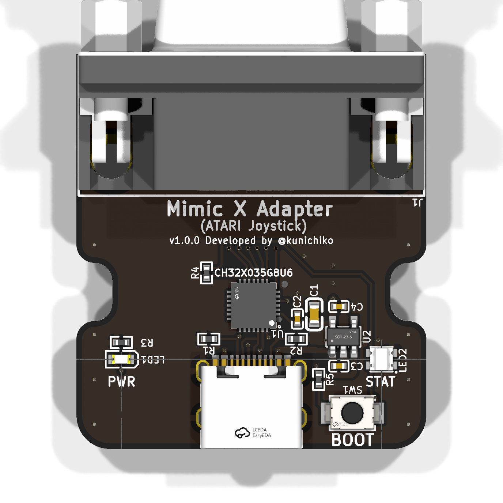
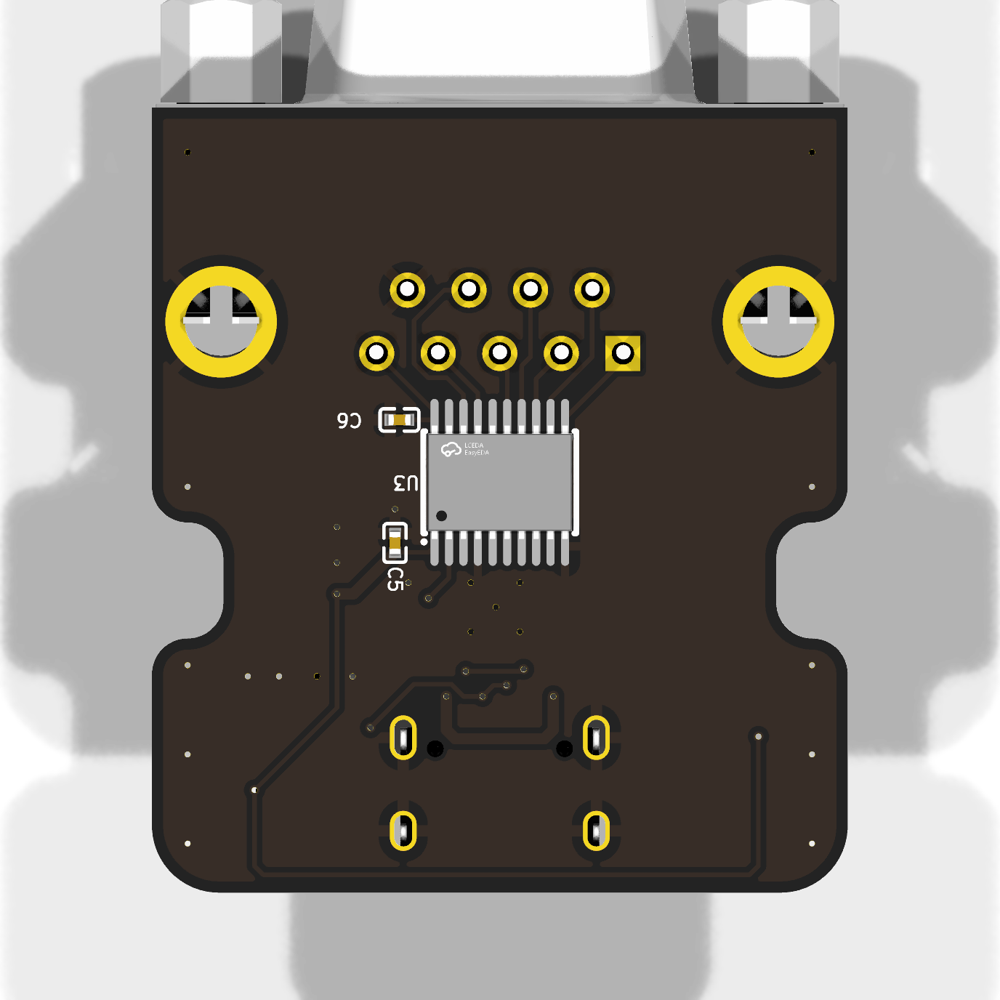

# atari-joystick

Mimic X — ATARI 仕様ジョイスティックアダプタ基板

*USB-MIDI to ATARI-standard 9-pin joystick adapter. Board rev 1.0.0,
fabricated at JLCPCB. Designed in [atopile](https://atopile.io) — the circuit
lives in [`atari_joystick.ato`](atari_joystick.ato), not in a schematic sheet.*

<p align="center">
  
  
</p>

- **ブロック図 / block diagram**:
  [PDF](docs/atari-joystick-block-diagram.pdf) ·
  [SVG](docs/atari-joystick-block-diagram.svg) — 全ブロック・全信号・電源
  ドメイン・ピン割当を 1 枚に収めた図
- **PCB レイヤープロット / layer plots**:
  [PDF](docs/atari-joystick-pcb.pdf) (silk / Cu / fab, 6 pages)
- **レイアウトをブラウザで**:
  [KiCanvas](https://kicanvas.org/?repo=https%3A%2F%2Fgithub.com%2Fkunichiko%2FMimicX-hardware%2Fblob%2Fmain%2Fatari-joystick%2Flayouts%2Fdefault%2Fdefault.kicad_pcb)
- **製造データ**: [`layouts/default/production/`](layouts/default/production)
  (Gerber + BOM + CPL, JLCPCB 発注そのまま)
- **USB VID:PID**: `0x1209:0x9210`

<!-- 実機写真を撮ったら docs/images/ に置き、下の行のコメントを外す:
<p align="center">
  
  
</p>
-->

## 用途

スマートフォン (USB-MIDI ホスト) から CH32X035 経由で、ATARI / メガドライブ 6
ボタンファイティングパッド互換のジョイスティック信号を出力する。X68000 等の
9pin D-SUB ジョイスティックポートに接続して使用する。

## 主要部品

| 部品 | 型番 / 仕様 | 備考 |
|------|-----------|------|
| MCU | WCH CH32X035G8U6 | QFN28 (4×4 mm)、48MHz、5V トレラント、USB Full-Speed 内蔵 |
| USB コネクタ | USB Type-C (Receptacle, 16pin, TYPE-C-31-M-12) | スマートフォンと接続 |
| 出力コネクタ | D-SUB 9pin **メス** (CONNFLY DS1037-09FNAKT74-0CC) | ATARI/X68000 ジョイスティックポート (ホスト側オスに直挿し) |
| LDO | LP5907MFX-3.3 (250 mA) | VBUS 5V → MCU VDD 3.3V |
| レベルシフタ | Toshiba TC7MPB9307FT (TSSOP-20) | 8-bit Dual-Supply Bus Switch、3.3V↔5V |
| BOOT ボタン | XUNPU TS-1088-AR02016 (3.9×3.0mm, 2 ピン) | リセット時 USB DFU 起動用 |
| その他 | ESD 保護 (USB), デカップリング 0.1µF / 4.7µF, USB Type-C CC 抵抗 5.1kΩ ×2 |

> 基板を小型化するため、デバッグ LED は実装していない (PB11 / PB12 は未使用)。
> 必要であれば後付けで VDD33 → LED → 470Ω → MCU ピンで追加可能。

## ピン割当 (CH32X035 → コネクタ)

ファームウェア `MimicX-firmware/src/functions/joystick/joystick.c` 参照。

| MCU ピン | 信号 | D-SUB 9pin | 機能 |
|---------|------|-----------|------|
| PA0     | COMMON / TH (TIM2_CH1) | Pin 8 | MD 6B 切替検出 (input capture + DMA) |
| PA7     | Up   | Pin 1 | アクティブ Low (open-drain 推奨) |
| PA5     | Down | Pin 2 | 同上 |
| PA3     | Left | Pin 3 | 同上 |
| PA2     | Right | Pin 4 | 同上 |
| PA6     | TRIG-A | Pin 6 | 同上 |
| PA4     | TRIG-B | Pin 7 | 同上 |
| PB11    | (未使用) | — | LED 省略のため空き (将来拡張用) |
| PB12    | (未使用) | — | LED 省略のため空き (将来拡張用) |
| —       | GND  | Pin 9 | ホスト側と共通 |
| —       | +5V (VCC_HOST) | Pin 5 | ホストの +5V をレベルシフタ B 側電源として受け入れ |

## D-SUB 9pin (ホスト側 = オス、当基板側 = メス) ピンアサイン

X68000 等のホスト機側 D-SUB 9pin ジョイスティックポートは **オス**。本基板は
そこに直挿しできるよう **メス** を実装する。

```
   5 4 3 2 1     (D-SUB 9pin Female, looking at the mating face)
    9 8 7 6
```

| Pin | 信号 (ATARI / X68000 標準) |
|-----|------|
| 1 | Up |
| 2 | Down |
| 3 | Left |
| 4 | Right |
| 5 | +5V (host-supplied) — レベルシフタ B 側 VCCB に接続 |
| 6 | TRIG-A |
| 7 | TRIG-B |
| 8 | COMMON (TH) |
| 9 | GND |

## 出力段の検討事項

- ATARI 規格では各信号線は本来 open-collector / open-drain。**5V トレラント**
  であっても CH32X035 の GPIO は出力 push-pull がデフォルトなので、ピンに
  直結するとホスト側 (X68000) のプルアップに対して干渉する可能性がある。
  - 案 A: **GPIO 出力モードを open-drain に設定** (ファーム側で `GPIO_CNF_OUT_OD`)
    かつ外付けプルアップなしで、ホスト側プルアップを利用
  - 案 B: 各信号にバスバッファ (74HC125 等) を入れる
  - 案 C: 個別 N-MOSFET (BSS138 など) で擬似 open-drain
- TH (PA0) は **入力**。MD 6 ボタンモードで本体からの信号変化を input capture
  で検出するため、ESD/サージ保護 (TVS ダイオード) の挿入を推奨

## 電源

本基板は **2 系統の電源** を用途別に取り込む構成 (x68000-keyboard と同じ流儀):

| レール | 供給元 | 用途 |
|---|---|---|
| **VBUS (5V)** | USB Type-C (スマホ等のホスト) | LDO で 3.3V に降圧して MCU と レベルシフタ A 側 (VCCA) を駆動 |
| **VDD33 (3.3V)** | LDO (LP5907MFX-3.3) | MCU 本体・LDO 後段デカップリング |
| **VCC_HOST (5V)** | ホスト D-SUB Pin 5 | レベルシフタ B 側 (VCCB) — 5V 信号レベル基準と同電位を取る |

ポイント:
- VBUS と VCC_HOST は基板上で **直接接続しない** (それぞれ別のレールとして分離)。
  逆流・逆給電のリスクが無くなる。
- レベルシフタ B 側電源をホスト側 +5V から取ることで、ホスト側信号レベルと
  完全に整合する (ホスト電源断のときは B 側も電位がなくなり、バススイッチが
  自然と high-Z 状態になる)。
- MCU 動作には USB 接続が必須。
- **要注意**: 接続先ホストが Pin 5 に +5V を供給しないモデル (古い Atari 系の
  一部) ではレベルシフタが動作しない。X68000 と Mega Drive はどちらも +5V を
  供給するため通常用途では問題ないが、汎用 ATARI 機への接続を考える場合は
  対応機種を要確認。

## レイアウトのヒント

- USB Type-C コネクタは基板端に配置
- D-SUB 9pin は反対側または隣接エッジに配置
- QFN28 (4×4 mm) 周りはデカップリング (4.7µF + 0.1µF) を近接配置 (VDD ピン直近)
- USB 信号 (DP/DM) は 90Ω 差動でルーティング (短ければそこまでシビアではない)

## 参考

- USB Type-C CC 1/2 ピンには 5.1kΩ プルダウンを VBUS と Source 認識のため必須
- 本基板は Sink (Device 側) のため、CC2 抵抗だけでも動作する場合があるが両方
  実装が無難
