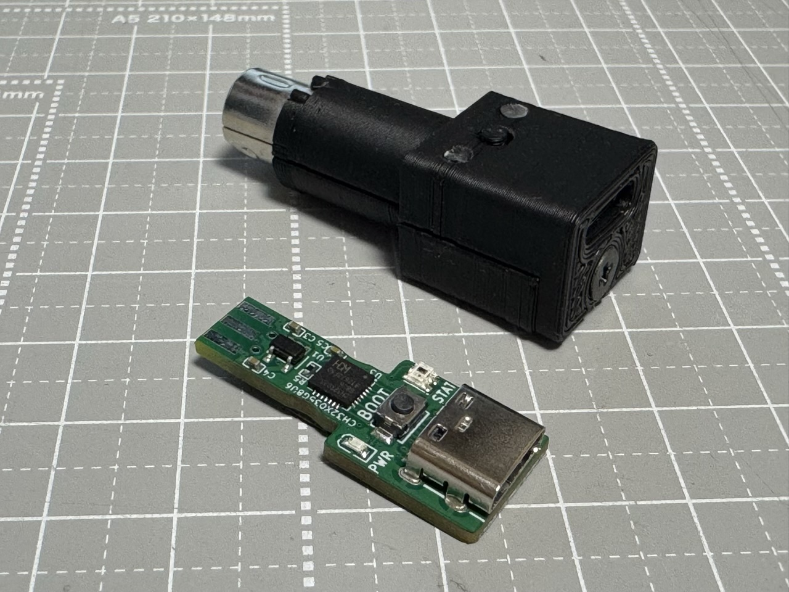
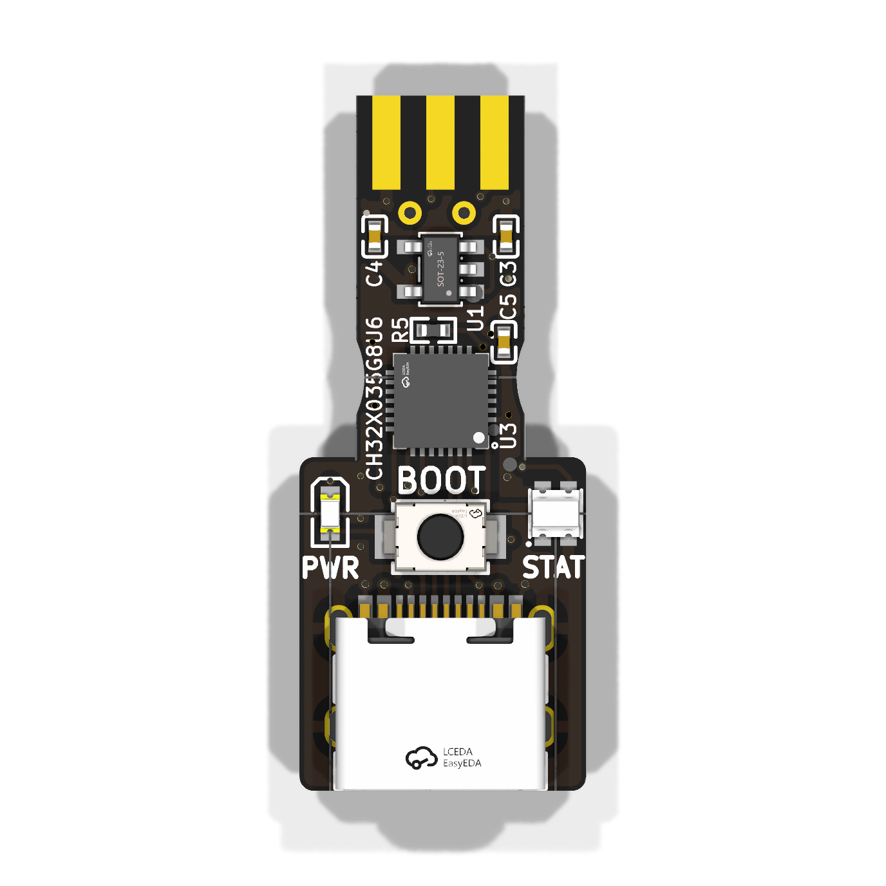
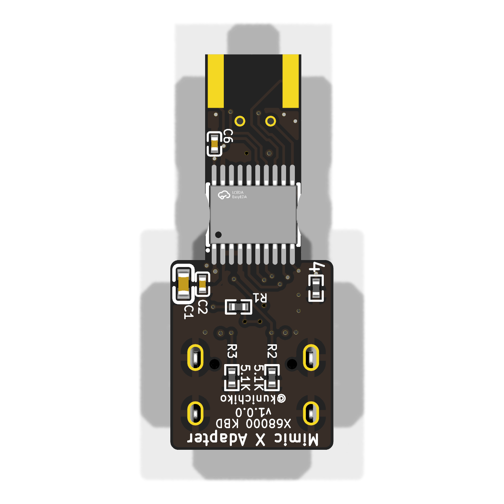

# x68000-keyboard

Mimic X — X68000 キーボードアダプタ基板 (キーボード + マウス相乗り対応)

*USB-MIDI to Sharp X68000 keyboard/mouse port adapter (mini-DIN 7P, 4-layer
board). Board rev 1.0.0 fabricated at JLCPCB; rev 1.0.1 (outline centering fix)
not yet ordered. Designed in
[atopile](https://atopile.io) — the circuit lives in
[`x68000_keyboard.ato`](x68000_keyboard.ato), not in a schematic sheet.*

<p align="center">
  
</p>
<p align="center"><sub>実装済みの基板と 3D プリントのケース (背景はカッティングマット)</sub></p>

<p align="center">
  
  
</p>
<p align="center"><sub>KiCad レイアウトの 3D レンダ (部品面 / はんだ面)</sub></p>

- **ブロック図 / block diagram**:
  [PDF](docs/x68000-keyboard-block-diagram.pdf) ·
  [SVG](docs/x68000-keyboard-block-diagram.svg) — 全ブロック・全信号・電源
  ドメイン・ピン割当を 1 枚に収めた図
- **PCB レイヤープロット / layer plots**:
  [PDF](docs/x68000-keyboard-pcb.pdf) (silk / Cu ×4 / fab, 8 pages)
- **レイアウトをブラウザで**:
  [KiCanvas](https://kicanvas.org/?repo=https%3A%2F%2Fgithub.com%2Fkunichiko%2FMimicX-hardware%2Fblob%2Fmain%2Fx68000-keyboard%2Flayouts%2Fdefault%2Fdefault.kicad_pcb)
- **製造データ**: [`layouts/default/production/`](layouts/default/production)
  (Gerber + BOM + CPL, JLCPCB 発注そのまま)
- **USB VID:PID**: `0x1209:0x9210`


## 用途

スマートフォン (USB-MIDI ホスト) から CH32X035 経由で、X68000 のキーボード
信号 (KEY TxD/RxD) およびマウス信号 (MSDATA) を生成し、X68000 本体の
ミニ DIN 7pin ポートに接続して使用する。

X68000 のキーボードコネクタは **マウス端子を兼用** しており、本基板も
1 つのコネクタで両方をエミュレートする (ファーム `BOARD_X68K_FULL`)。

## 主要部品

| 部品 | 型番 / 仕様 | 備考 |
|------|-----------|------|
| MCU | WCH CH32X035G8U6 | QFN28、48MHz、USB Full-Speed 内蔵、3.3V 駆動 |
| USB コネクタ | USB Type-C (Receptacle, 16pin) | スマートフォンと接続 |
| 出力コネクタ | Mini DIN 7pin オス (自作 `MiniDIN_7P_X68000`) | X68000 キーボード端子 (手配コネクタを基板に直付け) |
| LDO | LP5907MFX-3.3 (250 mA) | VBUS 5V → MCU VDD 3.3V |
| レベルシフタ | Toshiba TC7MPB9307FT (TSSOP-20) | 8-bit Dual-Supply Bus Switch、3.3V↔5V |
| BOOT ボタン | XUNPU TS-1088-AR02016 (3.9×3.0mm, 2 ピン) | リセット時 USB DFU 起動用 |
| その他 | デカップリング 0.1µF / 4.7µF, USB Type-C CC 抵抗 5.1kΩ ×2 |

> 基板上の状態表示は **電源 LED (緑 0603, 常時点灯)** と **フルカラー LED
> (WS2812B-2020-V6, シリアル制御 RGB)** の 2 個。PB3 / PB4 は引き続き未使用。

## ピン割当 (CH32X035G8U6 QFN28 → コネクタ)

> **注意 (重要)**: 旧版 README には `PA15–PA19` という記載があったが、これは
> CH32X035 別パッケージ (LQFP48 など) のピン名で、MimicX で採用している
> **CH32X035G8U6 (QFN28) には存在しない**。詳細は `../docs/CH32X035.md` §3 参照。
> 以下が QFN28 の実ピンに合わせた最新割当。

| QFN28 Pin | MCU 信号 | レベルシフタ | DIN 7pin | 方向 (MCU 視点) | 用途 |
|---:|---|---|---:|---|---|
| 22 | PB11 (USART1_RX, RX1_2) | a6↔b6 | Pin 4 (KEY TxD) | **IN** | X68000 本体からのコマンド受信 (2400/8N1) |
| 21 | PB10 (USART1_TX, default) | a4↔b4 | Pin 3 (KEY RxD) | **OUT** | キーコード送信 (2400/8N1) |
| 23 | PB12 (GPIO 入力) | a5↔b5 | Pin 5 (READY) | IN | 1=ホスト準備完了、Low 時送信抑止 |
| 20 | PB9 (USART4_TX, TX4_3) | a8↔b8 | Pin 2 (MSDATA) | OUT | マウスデータ送信 (4800/8N2) |
| 19 | PB8 (GPIO) | a7↔b7 | Pin 6 (REMOTE) | (FW 依存) | TV リモコン信号。用途は将来検討 |
| 13 | PB0 | — | — | OUT | フルカラー LED (WS2812B-2020-V6) DI 駆動。470Ω 直列ダンピング抵抗経由 |
| 14 | PB3 | — | — | — | 未使用 |
| 15 | PB4 | — | — | — | 未使用 |
| —  | (GND) | — | Pin 7 | — | 共通 GND |
| —  | (VCC2) | (B 側 VCCB) | Pin 1 (Vcc2 +5V) | — | X68000 本体の +5V をレベルシフタ B 側電源として受け入れ |

USART のリマップ設定 (`AFIO_PCFR1`):
- `USART1` は PB10/PB11 を使うため `USART1_REMAP` ビットの設定で
  `RX1_2` (= PB11) にマップする必要がある。
- `USART4` は PB9 の `TX4_3` リマップを使用 (MSDATA は送信のみで RX は不要)。

詳細はファームウェア `MimicX-firmware/src/functions/x68k_keyboard/` および
`x68k_mouse/` 参照。

## DIN ピン名の方向解釈 (重要)

X68000 サービスマニュアル上の `KEY TxD` / `KEY RxD` は **X68000 本体 (ホスト) 視点**
で命名されている:

| Pin | ラベル | データの流れ | MCU (= キーボード側) の動作 |
|----:|---|---|---|
| 3 | KEY RxD | ホストが**受信** ← キーボード | MCU は**送信** (TX) |
| 4 | KEY TxD | ホストが**送信** → キーボード | MCU は**受信** (RX) |

UART の一般則「片側の Tx は相手側の Rx に繋ぐ」を素直に適用すれば良い:
- ホストの TxD (Pin 4) → MCU の RX1 (PB11)
- ホストの RxD (Pin 3) ← MCU の TX1 (PB10)

## ミニ DIN 7pin (本体側 = メス、当基板側 = オス)

```
       _______
      /  4 3  \         (DIN 7pin Male, looking at the plug from outside)
     | 7  6  5 |
      \_2 1__/
```

本基板は **ユーザ手配のコネクタを直接はんだ付け** する想定で、フットプリントは
自作 (`parts/MiniDIN_7P_X68000/MiniDIN_7P_X68000.kicad_mod`) を採用している。
コネクタの実寸 (Hirose HMD-7P 系を想定) に合わせて KiCad の Footprint Editor
で本実装済み。差し替える場合は同ファイルを編集して `ato build` を再実行する。
X68000 サービスマニュアル準拠のピン配置:

| Pin | 信号 | 当基板での扱い |
|-----|------|---|
| 1 | Vcc2 (+5V) | レベルシフタ B 側 VCCB に接続 (X68000 から給電) |
| 2 | MSDATA (キーボード→本体) | MCU PB9 ← レベルシフタ |
| 3 | KEY RxD (キーボード→本体) | MCU PB10 (TX1) ← レベルシフタ |
| 4 | KEY TxD (本体→キーボード) | MCU PB11 (RX1) ← レベルシフタ |
| 5 | READY (本体→キーボード) | MCU PB12 ← レベルシフタ |
| 6 | REMOTE (TV リモコン用) | MCU PB8 ← レベルシフタ |
| 7 | GND | 共通 GND |

## 信号レベルとバッファ

- すべて **5V TTL**
- CH32X035 は **5V トレラントではない** (絶対最大定格 VIN ≤ VDD+0.3V =
  3.6V at VDD=3.3V)。詳細は `../docs/CH32X035.md` §5・§7 参照。
- そのため X68000 側 5V 信号と接続する全 5 ラインに **Toshiba TC7MPB9307FT
  (8 ch パッシブ FET バススイッチ、TSSOP-20)** を介す。
  - VCCA = VDD33 (3.3V、MCU 側) / VCCB = VCC2 (5V、X68000 本体の Vcc2) / OE = GND 固定
  - チャネル 4〜8 を使用 (a4/a5/a6/a7/a8)、未使用の 1〜3 は A 側を GND に落としてフローティング回避
- パッシブ FET 型 (FET パススルー) を選定する理由は ATARI アダプタと同じで、
  X68000 ホスト側 8255 + プルアップとの相性を考慮したもの。`../docs/CH32X035.md`
  §7 参照。

## 電源

本基板は **2 系統の電源** を用途別に取り込む構成:

| レール | 供給元 | 用途 |
|---|---|---|
| **VBUS (5V)** | USB Type-C (スマホ等のホスト) | LDO で 3.3V に降圧して MCU と レベルシフタ A 側 (VCCA) を駆動 |
| **VDD33 (3.3V)** | LDO (LP5907MFX-3.3) | MCU 本体・LDO 後段デカップリング |
| **VCC2 (5V)** | X68000 本体 DIN Pin 1 (Vcc2) | レベルシフタ B 側 (VCCB) — 5V 信号レベル基準と同電位を取る |

ポイント:
- VBUS と Vcc2 は基板上で **直接接続しない** (それぞれ別のレールとして分離)。
  逆流・逆給電のリスクが無くなる。
- レベルシフタ B 側電源を X68000 側 5V (Vcc2) から取ることで、ホスト側信号
  レベルと完全に整合する (ホストが電源断のときは B 側も電位がなくなるので、
  バススイッチが自然と high-Z 状態になる)。
- MCU 動作には USB 接続が必須 (スマホからのバスパワー 5V → LDO で 3.3V)。
  X68000 単体で電源を取って動作させたい場合は本構成では非対応。

## レイアウトのヒント

- USB Type-C コネクタは基板の一辺に
- ミニ DIN 7pin は反対側エッジ。X68000 本体への取り回しを想定して
  ケーブル方向を考える
- QFN28 周りはデカップリング (4.7µF + 0.1µF) を近接配置
- USB 信号 (DP/DM) は 90Ω 差動でルーティング
- KEY TxD / KEY RxD / MSDATA / READY / REMOTE は 1 つの DIN コネクタに
  集約、ESD 保護 (TVS) を入れることを推奨 (TODO)

## 参考

- USB Type-C CC 1/2 ピンには 5.1kΩ プルダウン (VBUS / Source 認識のため必須)
- READY は X68000 起動時にしばらく Low のままなので、送信キューを内部に持つ
  実装を前提 (FW 側で対応済み)
- マウス機能を別基板に分けたい場合は、`functions/x68k_mouse/` を外して
  USART4 関連回路を不実装にし、コネクタも MSDATA を未配線にできる
- REMOTE (Pin 6) は X68000 純正キーボード上の TV リモコン受光部信号。
  当基板では PB8 GPIO に接続しておくだけで、用途は将来 FW 側で検討する
